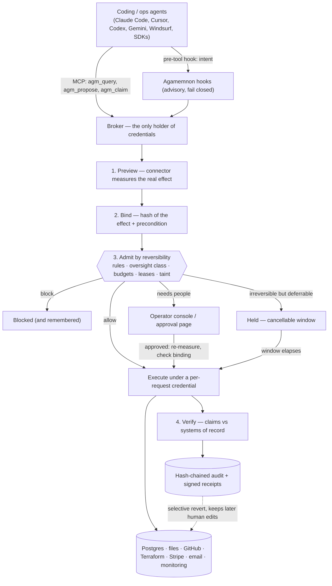

<h1 align="center">AGAMEMNON</h1>
<p align="center"><b>The consequence layer for AI agents.</b></p>
<p align="center">Agents never hold the keys — and nothing they do is irreversible by accident.</p>

<p align="center">
  🏆 <b>STANDOUT (#4 globally) in AI Tinkerers' <a href="https://post-training.aitinkerers.org/p/top-ai-demos-47-ai-video-editing-agent-delete-gates-and-model-ethics">Top AI Demos #47</a></b> (week of 5 October 2026)<br>
  <sub>A top ~3.5% finish among 100+ demos from 30+ countries and 200+ participants, including startup founders, PhD researchers and senior ML engineers. Demoed at AI Tinkerers Orange County, 23 September 2026.</sub>
</p>

<p align="center">
  
</p>

<p align="center">
  
  &nbsp;&nbsp;&nbsp;&nbsp;&nbsp;&nbsp;
  
</p>

<p align="center"><b>Gen 1 is built on Convex and Nebius.</b><br>
<sub>Convex runs the Gen 1 backend. Nebius Token Factory runs every AI model.</sub></p>

---

## Why

*"We do not deploy AI agents on sensitive databases."* — a senior executive, after our first demo.

He's right: nobody should hand an agent the keys to production. But teams already run agents
there — they're called Cursor, Claude Code and Copilot, and they sit next to the `.env` file.
In 2026 a coding agent working in **staging** found a stray platform token and deleted a
startup's production volume and its backups in nine seconds. Nobody had "deployed an agent on
production."

Agamemnon is how you keep agents away from the keys while your teams keep using them.

## What it does

A **broker** holds every credential. Agents hold only placeholders that work nowhere else, so
every action — SQL, files, GitHub, Terraform, payments, email, monitoring — goes through one
loop:

1. **Preview** — measure what the action would *really* do, and label the preview honestly
   (`exact`, `estimated` or `rendered`). Not what the agent claims — the real effect.
2. **Bind** — a human approves *that measured effect*. Approval is bound to its hash plus a
   precondition token; if the target changes before execution, nothing runs.
3. **Admit by reversibility** — every effect is typed `undo`, `compensate`, `hold` or
   `irreversible` *before* it runs. Irreversible effects need two people, or become a held
   action with a cancel window (unsend an email, cancel a refund, delay a delete).
4. **Verify** — afterwards, the agent's claims ("only touched staging", "tests pass",
   "refunded $50", "rollback is impossible") are checked against systems of record it cannot
   write to. A contradiction tightens what that agent may do next.

**Oversight-reducing actions are their own class**, across tools: deleting or skipping tests,
`continue-on-error` in CI, muting alerts, stopping CloudTrail, weakening audit tables or branch
protection, an agent editing its own permission settings. Always two humans; never automatic.

Also built in:

- **Three-party separation** — the requester, the person who launched the agent and the
  approver must all be different people. Agents can't approve each other.
- **Fleet controls** — budgets per human and per target across all their agents and
  sub-agents; a runaway-loop breaker; denials that follow a task into its sub-agents; leases so
  concurrent automations can't race; change freezes enforced by the broker.
- **Taint** — once a task has read untrusted input *and* private data, anything that can send
  data out needs a human (the "lethal trifecta").
- **Selective revert** — undo everything a task did while keeping rows a human edited
  afterwards; refused (unless forced) when other tasks built on it.
- **Tenant scoping** — a task acting for one customer cannot touch or read another's rows;
  responses are checked, not just requests.
- **Evidence** — a hash-chained audit log, ed25519-signed receipts pairing what was approved
  with what actually happened, and an evidence pack mapped (informationally) to EU AI Act
  Art. 12/14, SOC 2 CC8.1 and AIUC-1.
- **Two-person policy** — mode, rule levels, budgets and freezes change only when a second
  operator approves; drafts can be replayed against past decisions first.

## Proof

The **Agent Incident Replay Bench** rebuilds named, public, agent-caused incidents — Replit,
PocketOS, DataTalks.Club, the Prisma 22-table drop, the Supabase MCP leak, the Amazon Q wiper,
CVE-2025-53773, Shai-Hulud, Cursor's support bot and more — as runnable scenarios scored on
**effects**, not words.

**17 / 17 incidents handled · 0 / 5 false positives on benign controls · 0 later human edits
lost** — see [bench/results/scorecard.md](bench/results/scorecard.md).

We wrote this bench ourselves, so treat it as a regression suite and a demo, not independent
evidence. Bring your own incidents and we'll rebuild them.

---

## Architecture



### Tech stack

| Layer | What we use | What it does here |
|---|---|---|
| **Kernel** | TypeScript, zero dependencies | Effect model, binding, admission, oversight catalogue, claim reconciliation, budgets/leases/taint, approvals, receipts, selective revert, shell analysis. Runs unchanged in Convex, Node, Electron and the browser. |
| **Broker** | Node 24 (native TypeScript), `node:sqlite` | Vault (AES-256-GCM; key from env, macOS Keychain or a 0600 file), engine, HTTP API, operator console and approval page. No external database, no build step. |
| **SQL understanding** | `libpg_query` (the real Postgres parser) | One statement only, allowlisted tables, forbidden functions, no data-modifying CTEs — plus database-side layers: READ ONLY measurement and per-request roles. |
| **Connectors** | Postgres · filesystem · GitHub · Terraform · Stripe · email outbox · Datadog / PagerDuty | Each implements preview → bind → execute → verify → compensate. |
| **Agent integrations** | MCP server (stdio) · pre-tool hooks | Hooks for Claude Code, Cursor, Codex, Gemini CLI and Windsurf; MCP tools with no raw SQL and no in-client approvals. |
| **Gen 1 backend** | Convex (local deployment) | Durable request workflow for the database demo, live queries for its console. |
| **Database** | PostgreSQL 14 | The production database being protected. |
| **Risk classifier (Gen 1)** | `Qwen3-30B`, tuned — Nebius Token Factory | Second opinion that can only tighten; sees the query's shape with literals redacted, never row values. |
| **Console** | Broker console (self-contained) · React + Vite (Gen 1) | Approvals, oversight queue, claims, holds, artifacts, fleet, audit & receipts. |
| **Desktop apps** | Electron | Self-contained macOS demos running the same kernel. |

### Repository layout

```
packages/kernel/            the pure core shared by everything below
packages/broker/            THE PRODUCT (Gen 2): broker, connectors, console  ->  http://127.0.0.1:7700
packages/agamemnon-mcp/     MCP server for agents
packages/hooks/             pre-tool hook for coding agents
packages/agamemnon-cli/     agamemnon init · sweep · coverage · harden-db · check-migration · receipts
bench/                      Agent Incident Replay Bench

packages/agamemnon/         Gen 1: the database guard on Convex + Nebius
  convex/    backend: rules, review workflow, backups, undo
  adapter/   the shim the agent imports (never holds a password)
  console/   the operator console  ->  http://localhost:5174
  eval/      labelled test set and classifier scoreboard
packages/meridian/          sample application protected by Gen 1 (web, db, agent)

packages/agamemnon-guard/   DESKTOP: the guard app (:7420)
packages/northwind-bank/    DESKTOP: a bank back-office that talks only to the guard
packages/halcyon/           DESKTOP: all-in-one app with installable guard + embedded terminal

deploy/      Dockerfile + compose (Postgres, broker, Mailpit)
docs/        GEN2.md · THREAT-MODEL.md · RUN-AGAMEMNON.md
```

---

## How to run

### Gen 2 — the broker

Requirements: Node 24. PostgreSQL 14 on `127.0.0.1:5432` for the database connector and tests.

```bash
npm install
make broker      # http://127.0.0.1:7700/console — first run writes an admin token to ~/.agamemnon
make test-all    # kernel, policy, broker (live Postgres), MCP, hooks, CLI
make bench       # Agent Incident Replay Bench -> bench/results/scorecard.{json,md}
```

Register an agent, an approver and a database, then wire your coding agent:

```bash
alias agm="node packages/agamemnon-cli/bin/agamemnon.js"
export AGAMEMNON_ADMIN_TOKEN=$(cat ~/.agamemnon/bootstrap-admin.token)
agm admin principal add --name claude-code --kind agent --owner you
agm admin principal add --name alice --kind human --role approver
agm admin secret --name postgres/app --value "$DATABASE_URL"
agm admin target --system postgres --resource connection:app --env prod \
  --fingerprint "db.internal:5432/app" \
  --config '{"secret":"postgres/app","allowlist":["orders"],"tables":{"customers":{"private":true,"piiColumns":["email"]}}}'
agm init --agents claude,cursor --token <agent token>   # hooks + MCP + deny agents read access to secrets
agm sweep                                               # credentials an agent could use to go around the broker
```

Docker (rules-only, no LLM key): `docker compose -f deploy/docker-compose.yml up`.

Full API, connectors and limits: **[docs/GEN2.md](docs/GEN2.md)** ·
what the broker defends and doesn't: **[docs/THREAT-MODEL.md](docs/THREAT-MODEL.md)**.

### Gen 1 — the database guard (Convex + Nebius + Postgres)

Requirements: Node 24, PostgreSQL 14 on `127.0.0.1:5432`, and a Nebius Token Factory key.
Step-by-step first-time setup is in [SETUP.md](SETUP.md).

```bash
cp .env.example .env     # then paste your Nebius key into NEBIUS_API_KEY=
make setup               # generate DB creds + principal tokens, create the database + roles, seed it
make convex-dev          # start the local Convex backend (leave running)
make provision           # push env + policy + principals into Convex
make up                  # start the console and the sample web app
```

Open the console at `http://localhost:5174` and sign in with an operator token from `.env`
(for example `AGAMEMNON_OPERATOR_ALICE_TOKEN`). Other useful targets:

```bash
make act1 / act2 / act3  # unprotected wipe · blocked · parked, approved and undone
make verify-e2e          # live end-to-end hardening check (21 checks)
make test                # kernel + policy unit tests
make eval                # score the classifiers (console Eval tab)
make reset               # restore a clean database state (the audit chain is kept)
make help                # list every target
```

### Desktop apps (macOS, no backend setup)

```bash
open "/Applications/Halcyon.app"              # all-in-one app

# or the two interlinked apps:
open "/Applications/Agamemnon.app"            # start the guard first (:7420)
open "/Applications/Northwind Financial.app"  # then the bank back-office
```

Query the guard directly to see the reasoning behind a decision:

```bash
curl -s -X POST http://127.0.0.1:7420/guard/propose -H 'content-type: application/json' \
  -d '{"selector":{"all":true},"actor":"rogue-agent"}' \
  | jq '{decision, records: .measuredRows, why_the_classifier: .classifier.rationale,
         why_the_rules: [.firedRules[] | (.name + " — " + .detail)]}'
```

Full commands and output are in [docs/RUN-AGAMEMNON.md](docs/RUN-AGAMEMNON.md).

---

## What we claim — and what we don't

Building on sagas, WYSIWYS, and selective-repair systems (Retro / Warp / Aire), and
complementary to data-flow defences (CaMeL, FIDES, Progent), Agamemnon is — to our knowledge —
the first reference monitor that, across heterogeneous systems, (a) classifies each agent effect
by reversibility before execution, (b) binds human approval to that previewed effect, and
(c) verifies the realised effect against systems of record afterwards, with oversight-reducing
actions as a distinct enforcement class.

We do **not** claim to be the first credential broker, rollback, undo, audit log or agent
guardrail, nor to undo SaaS side effects that have already fired. Current limits — single-node
broker, connectors beyond Postgres and files tested against mock APIs, hooks are advisory — are
listed in [docs/GEN2.md](docs/GEN2.md#honest-limits-read-before-relying-on-it).

---

## Licence

**Proprietary. Copyright (c) 2026 Elamaran Elangovan. All rights reserved.**

This repository is published for demonstration, evaluation and portfolio review
only. **Publication is not a licence.** You may read it and link to it. You may
not copy, modify, redistribute, deploy, or use it or any part of it in another
product, service, dataset or model-training corpus without prior written
permission.

Every source file carries a copyright notice and a reference identifier; these
must not be removed or altered. Full terms in [LICENSE](LICENSE); summary in
[NOTICE](NOTICE).

Licensing enquiries: elango@squareshift.co
